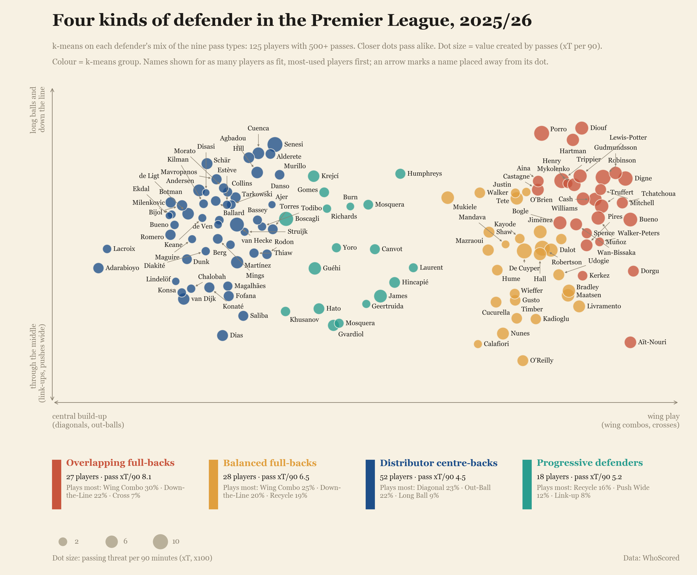

# EPL Player Clustering

**What kinds of passes do Premier League players play, and can a player be described by the mix of passes he plays?**

k-means on 4.5 million open-play passes (2013/14 to October 2026) gives nine pass types. Each player-season becomes a mix of those nine. Players are then grouped within position (defenders, midfielders, attackers) with a second k-means, and the result is an interactive map you can hover over.

**Interactive explorer:** https://chuongt1311-droid.github.io/EPL-Player-Clustering/ *(live once GitHub Pages is switched on for this repo)*



## What is in this repo

| Path | What it is |
|---|---|
| [`notebooks/EPL_Player_Clustering.ipynb`](notebooks/EPL_Player_Clustering.ipynb) | The whole project, start to end, with outputs: data preparation, the risk model, k-means, validation, players, similarity search, value, role drift, player groups, and the page. |
| [`docs/index.html`](docs/index.html) | The interactive explorer (defenders, midfielders, attackers; every season 2013/14 to 2026/27 so far). Served by GitHub Pages. |
| [`build_site.py`](build_site.py) | Writes the page from the notebook's results. |
| [`data/`](data/) | Small derived files: the nine pass types, player-season pass mixes with their group, and the xT grid. No raw event data. |
| [`reports/`](reports/) | A technical report, a student-style write-up of how the project was made, and a quality review of my own work. |
| [`images/`](images/) | Charts used in the write-ups. |
| [`tools/`](tools/) | Scripts that assemble and execute the notebook. |

## The short version of what I found

- **Nine pass types**, from where a pass starts, how far it goes toward goal and sideways, and whether it was lofted or a cross: The Recycle, The Link-up, The Wing Combo, The Diagonal, The Cross, The Out-Ball, The Push Wide, The Down-the-Line, The Long Ball. They are reproducible but form a continuum (silhouette about 0.2), not separate islands.
- **Risk and value go together.** Completion runs from 96% (The Recycle) to 23% (The Cross). Crosses are about 3% of passes but about 37% of all pass threat (xT).
- **A player's mix is a stable trait** (split-half reliability 0.95 to 0.99). Position explains about half of how players differ; what is left within position is still reliable.
- **Position changes show up in the passing.** Eleven of the twelve biggest one-season shifts are real position changes (for example Ben White, centre-back to right-back).
- **The league changed.** Goalkeepers' long forward balls fell from about 53% to 33% of their open-play passes in a decade. Midfielders barely changed.
- **Player groups within position** (k chosen by stability, not by eye): four kinds of defender, three of midfielder, four of attacker, pooled over all seasons so a player can move between groups.

## Running the notebook

```bash
python -m venv .venv
.venv/Scripts/activate        # on macOS/Linux: source .venv/bin/activate
pip install -r requirements.txt
jupyter lab notebooks/EPL_Player_Clustering.ipynb      # or open it in VS Code
```

The raw event data (WhoScored match files and a standard-format export) is **not** in this repository. The cells that need it say so, and the outputs stored in the notebook come from my run with the data. To rerun those parts yourself, point the notebook at your own copies:

```bash
export EPL_RAW="path/to/ENG-Premier League"      # folders like 2024-25/<date>__<id>__<teams>/raw.json
export EPL_SPADL="path/to/spadl/exports"          # actions_<tag>.parquet and games_<tag>.parquet
```

## Honest limits

- The types and groups are useful slicings of a continuum, and the names are my reading of the numbers.
- The provider's "Chipped" tag changed its behaviour partway through the period (including inside 2023/24), so the long-ball clusters were merged. Details in the notebook (Part 5.5).
- Pass xT only values completed passes; it ignores carrying, defending and off-ball work. xT before 2024/25 uses a grid fitted on the same data, so compare within a season.
- The current season (2026/27) is only 8 matches per team old; the page marks it provisional.

## Data note

The event data comes from WhoScored. I do not redistribute it. The files in `data/` are my own derived aggregates (per player-season pass-type shares, minutes, pass xT, assigned group, and map coordinates). If you reuse this work, check the data provider's terms first.

## Credits

Inspired by the PITCH IQ post "Player Roles Clustering" by Steve Ahiabah-Quarshie ([steveaq.github.io/Player-Roles-Clustering](https://steveaq.github.io/Player-Roles-Clustering/)): I started by rebuilding its approach, then changed it.

Built with an AI coding assistant (Claude Code) under my direction; I made the decisions and reviewed every check and chart.

## Licence

MIT, see [`LICENSE`](LICENSE).
